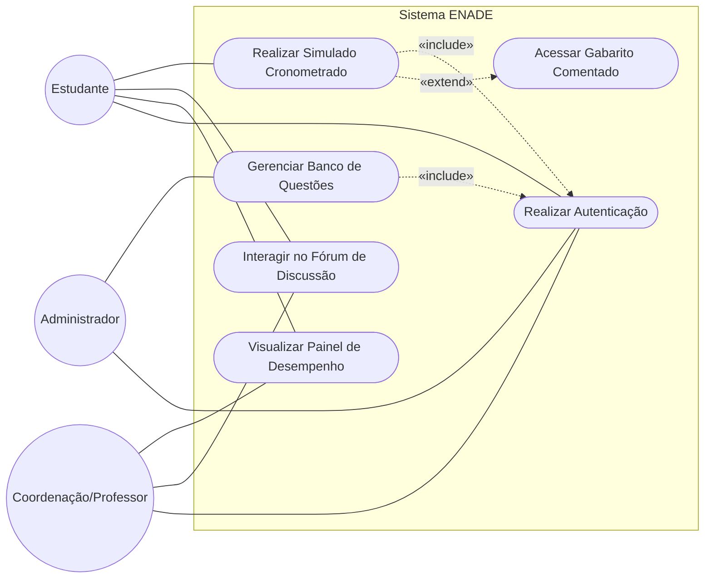
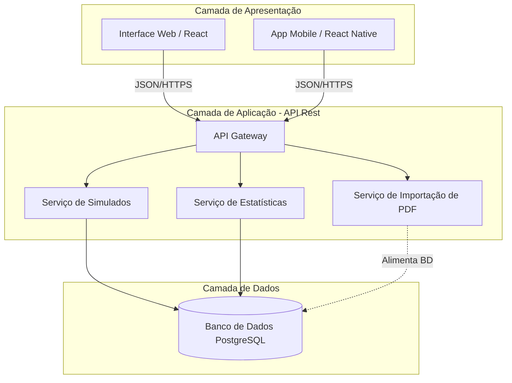
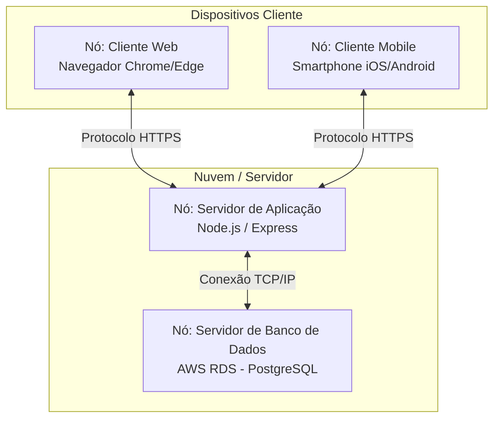

# Projeto de Extensão - Plataforma de Gestão do Conhecimento e Aprendizagem (ENADE)

**Disciplina:** Requisitos e Modelagem de Sistemas
**Instituição:** Universidade de Fortaleza (UNIFOR)

---

## 1. Documento de Visão

O Exame Nacional de Desempenho dos Estudantes (ENADE) é um componente curricular obrigatório e um indicador fundamental da qualidade do ensino superior. No entanto, os estudantes enfrentam dificuldades no preparo devido à falta de materiais organizados, simulados práticos e feedback estruturado sobre o seu desempenho.

A solução proposta é o desenvolvimento de um **Sistema Web/Mobile de Questões Comentadas do ENADE**. A plataforma atuará como uma ferramenta de gestão do conhecimento, centralizando provas passadas, gerando simulados cronometrados, oferecendo gabaritos comentados e painéis gráficos de desempenho para apoiar estudantes, professores e coordenações. O impacto esperado inclui a democratização do acesso a materiais de qualidade e a melhoria do desempenho das turmas.

---

## 2. Identificação de Stakeholders

* **Estudantes de Graduação:** Usuários diretos, foco principal da plataforma, que realizarão as avaliações, simulados e interagirão nos fóruns.
* **Professores:** Atuam como apoio pedagógico, validam gabaritos comentados e orientam ações de reforço com base nos dados gerados.
* **Coordenações de Curso:** Acompanham o desempenho institucional das turmas, filtram indicadores e planejam intervenções curriculares.
* **Administradores do Sistema:** Responsáveis por manter a infraestrutura, gerir o banco de questões e realizar a importação de novas provas do INEP.

---

## 3. Roteiro e Resultados de Entrevistas

A elicitação foi conduzida utilizando roteiros semiestruturados com os principais stakeholders.

**Roteiro de Perguntas:**

1. Como você realiza o seu preparo para provas de longa duração como o ENADE atualmente?
2. Quais são as suas maiores dificuldades ao buscar questões passadas do INEP?
3. Para coordenação: Quais indicadores ou gráficos são essenciais para diagnosticar deficiências da turma?
4. Qual a importância da interação com outros alunos/professores no esclarecimento de dúvidas?

**Resultados / Descobertas:**

* Os estudantes apontaram que baixar PDFs brutos do INEP é ineficiente e dificulta a filtragem por temas.
* Foi detectada uma forte necessidade de testar a gestão do tempo, justificando a criação de simulados cronometrados.
* Coordenadores ressaltaram que precisam visualizar gargalos de aprendizado (ex: formação geral vs. específica) em dashboards intuitivos.
* Os alunos valorizam o formato colaborativo, onde podem ver a explicação formal da questão e debater o raciocínio.

---

## 4. Requisitos

### Requisitos Funcionais (RF)

* **RF01:** O sistema deve permitir o cadastro e a autenticação segura de diferentes perfis de usuário (Estudante, Professor/Coordenação, Administrador).
* **RF02:** O sistema deve permitir ao administrador a importação de provas em PDF do INEP para alimentar o banco de dados.
* **RF03:** O sistema deve classificar as questões por ano, curso/área de conhecimento e componente (formação geral e conhecimento específico).
* **RF04:** O sistema deve possibilitar a geração e execução de simulados com tempo cronometrado.
* **RF05:** O sistema deve exibir gabaritos detalhadamente comentados após a conclusão de questões ou simulados.
* **RF06:** O sistema deve possuir um fórum de discussão integrado e específico para cada questão.
* **RF07:** O sistema deve gerar relatórios e gráficos de estatísticas de desempenho por área de conhecimento (individual e por curso).

### Requisitos Não Funcionais (RNF)

* **RNF01:** A interface do sistema deve ser responsiva, funcionando adequadamente em plataformas Web e Mobile.
* **RNF02:** O sistema deve garantir a privacidade e segurança dos dados, estando em conformidade com a LGPD.
* **RNF03:** O sistema deve apresentar tempos de resposta inferiores a 2 segundos para a submissão de respostas em simulados.
* **RNF04:** A plataforma deve possuir alta disponibilidade, especialmente em períodos que antecedem a aplicação do exame oficial.

---

## 5. Regras de Negócio

* **RN01 (Acesso de Conteúdo):** O acesso a gabaritos comentados só deve ser liberado ao estudante após a submissão da resposta daquela questão (para evitar consultas prévias).
* **RN02 (Autenticação Institucional):** A extração e cruzamento de dados institucionais (identificação de enadistas/não enadistas) só poderá ocorrer mediante integração autorizada e sob restrições da LGPD.
* **RN03 (Cronômetro):** Nos simulados, caso o tempo cronometrado se esgote, o sistema deve encerrar a prova automaticamente e registrar apenas as questões já respondidas.

---

## 6. Backlog Priorizado

Organizado no modelo de Histórias de Usuário, priorizado por valor de negócio.

| ID             | História de Usuário (User Story)                                                                                               | Prioridade |
| -------------- | -------------------------------------------------------------------------------------------------------------------------------- | ---------- |
| **US01** | Como *administrador*, quero *importar provas do ENADE em PDF* para *alimentar o banco de questões rapidamente*.           | Alta       |
| **US02** | Como *estudante*, quero *me cadastrar e fazer login* para *ter acesso ao sistema*.                                         | Alta       |
| **US03** | Como *estudante*, quero *fazer um simulado com limite de tempo* para *treinar minha agilidade*.                            | Alta       |
| **US04** | Como *estudante*, quero *ver o gabarito comentado ao fim da prova* para *entender meus erros*.                             | Alta       |
| **US05** | Como *coordenação*, quero *visualizar gráficos de desempenho por tema* para *diagnosticar as deficiências do curso*.   | Média     |
| **US06** | Como *estudante*, quero *comentar e interagir na página de uma questão* para *tirar dúvidas com professores e colegas*. | Média     |
| **US07** | Como *professor*, quero *filtrar questões por competência* para *utilizá-las em sala de aula*.                          | Baixa      |

---

## 7. Diagramas UML

### 7.1 Diagrama de Casos de Uso

Mapeia a interação dos atores com as funcionalidades do sistema.

### 1. Diagrama de Casos de Uso

### 2. Diagrama de Componentes

### 3. Diagrama de Implantação

