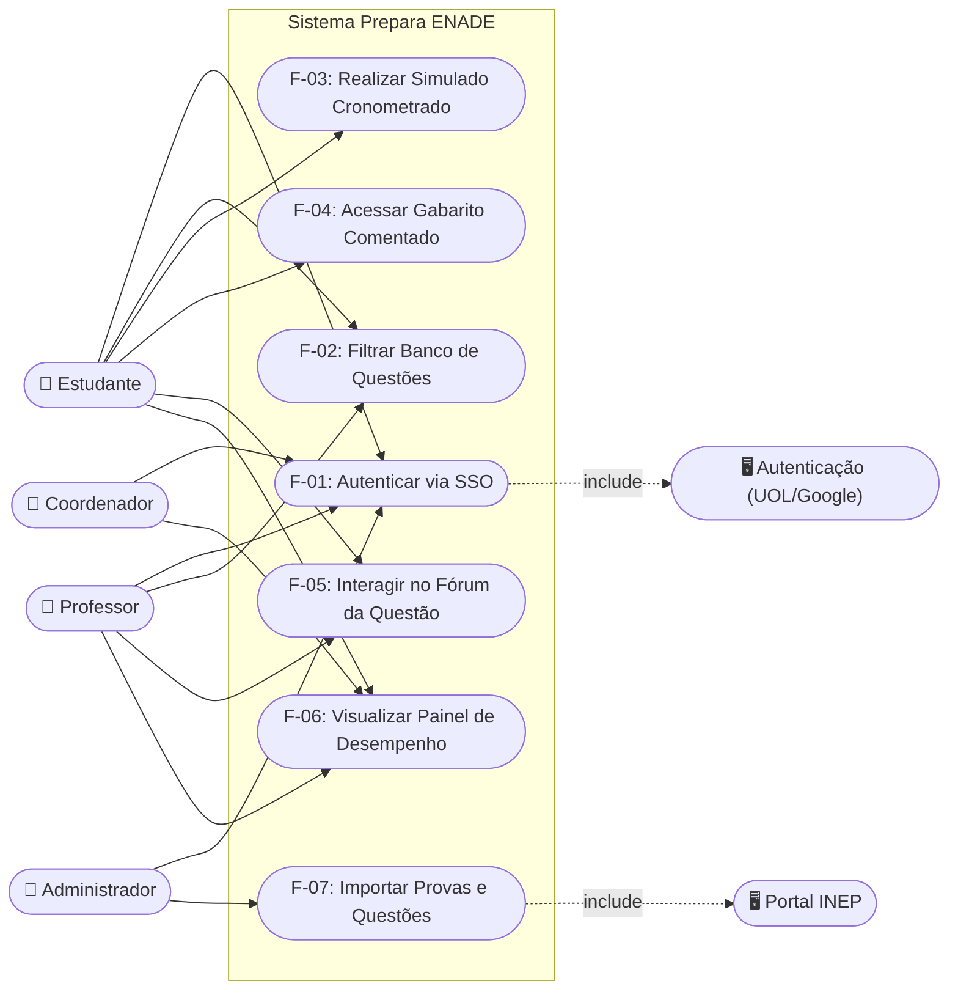
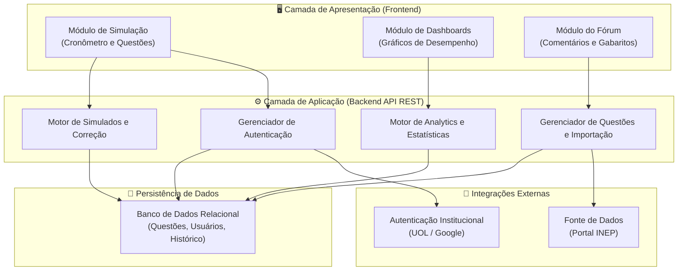
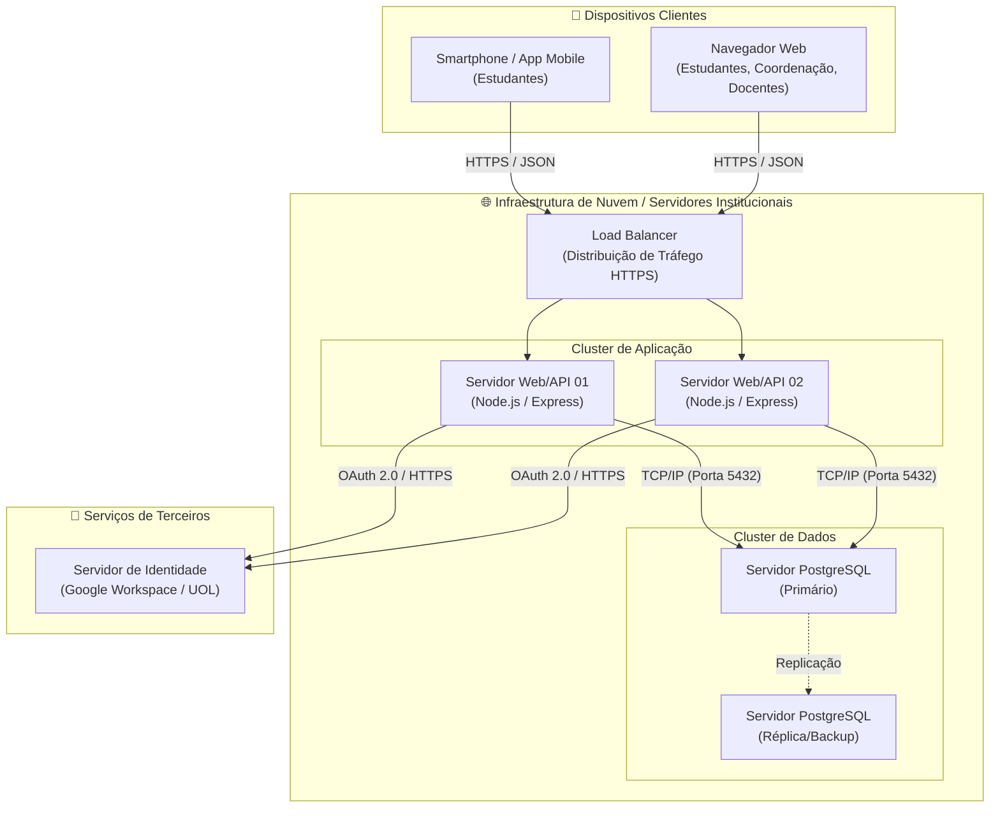
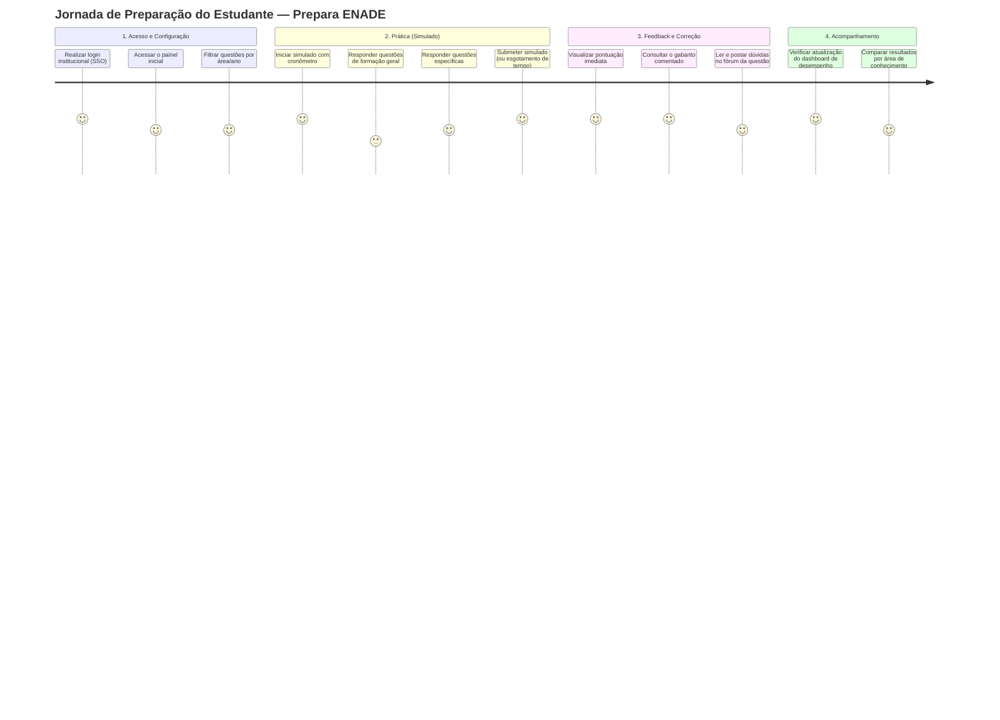

# Modelagem UML Inicial — Prepara ENADE

> **Projeto de Extensão — Plataforma de Gestão do Conhecimento e Aprendizagem (ENADE)**
> Artefatos da Sprint 1: Diagramas de Casos de Uso, Componentes e Implantação[cite: 16].

## 1. Diagrama de Casos de Uso

Este diagrama ilustra as interações entre os atores principais (Estudante, Coordenador, Professor e Administrador) e os casos de uso mapeados no Documento de Visão[cite: 15].

## 2. Diagrama de Componentes

Descreve a estrutura modular da plataforma e como os subsistemas se comunicam para atender aos requisitos arquiteturais de uma aplicação web/mobile focada na gestão pedagógica[cite: 15, 22].

## 3. Diagrama de Implantação

Representa a infraestrutura física e topológica necessária para hospedar a aplicação web/mobile, garantindo segurança e conformidade com as regras de negócio de proteção de dados[cite: 22].

## 4. Mapa de Histórias de Usuário (User Journey)

Uma visão cronológica da interação do estudante com o sistema para a realização de um ciclo completo de estudo para o ENADE[cite: 13, 15].

